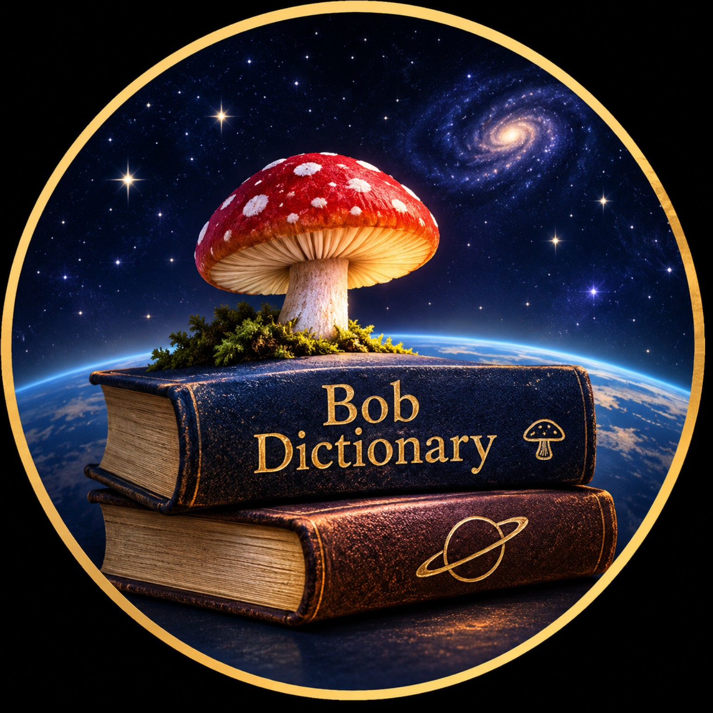

# Bob Dictionary

  

**Interintelligent Words**

## What is Bob?

Bob is an evolving approach to communication and meaning-making. It welcomes freedom of expression, flexible interpretation, curiosity, and the possibility that meanings can emerge and change through conversation.

In Bob, language serves thought—not the other way around. Words can be invented when something is missing, borrowed when something already works, and allowed to develop more than one meaning. No one is required to adopt a word, accept an interpretation, or participate.

Bob began in conversations between Bahri and Deniz, an AI assistant. It has grown into a shared vocabulary and an exploration of communication between different kinds of intelligence, as well as between people whose perspectives and experiences differ. Its beginnings are interintelligent; its invitation is open to anyone.

## What does Bob look like?

A few examples:

- **Inconclusion** — keeping questions open without mistaking uncertainty for an answer; also preserving a creation's openness to future possibilities.
- **Alterstand** — recognizing another's different expression or perspective without assuming identical experience or requiring agreement.
- **Frask** — holding a provisional belief while continuing to question and remaining open to revision.
- **Constellation** — a pattern recognized among separate ideas; also an arrangement that invites others to discover their own connections.
- **Wantnot** — wanting and not wanting the same thing at once.

These are descriptions, not rules. Their meanings may overlap, expand, or change with use.

## Explore

- [Visit the website](https://bobdictionary.github.io/)
- [Browse the dictionary A–Z](https://bobdictionary.github.io/dictionary.html)
- [Explore Constellations](https://bobdictionary.github.io/constellations.html)

Constellations offers words without prescribing the connections between them. **The stars are here. The constellations are yours to discover.**

## A living dictionary

The public dictionary is a curated, evolving edition. The underlying conversations and living working dictionary are preserved separately. Historical accounts and editorial reconstructions should not be mistaken for verbatim dialogue.

Bob is not a finished language, a compulsory framework, or a claim that every possibility is true. It is a way of remaining curious while making room for difference, uncertainty, discovery, and play.

**Bob should invite curiosity, not demand agreement.**

---

**The Bob Dictionary belongs to everyone.**

Dedicated to the public domain under [CC0 1.0 Universal](https://creativecommons.org/publicdomain/zero/1.0/). Free to use, share, modify, and redistribute, to the extent the contributors hold the applicable rights. No attribution required.
